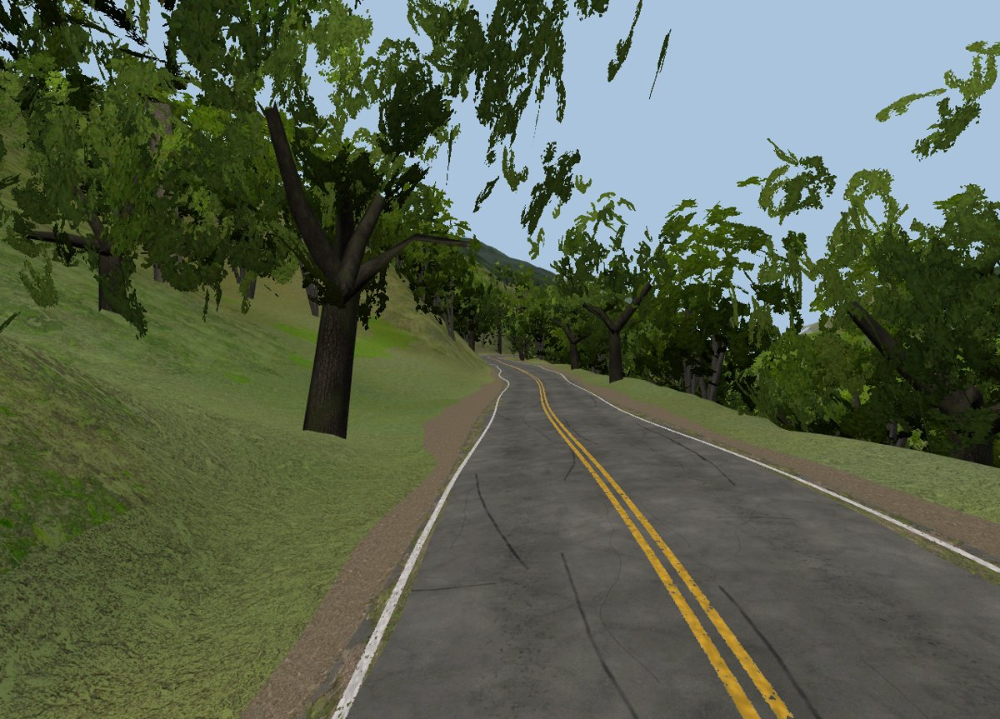
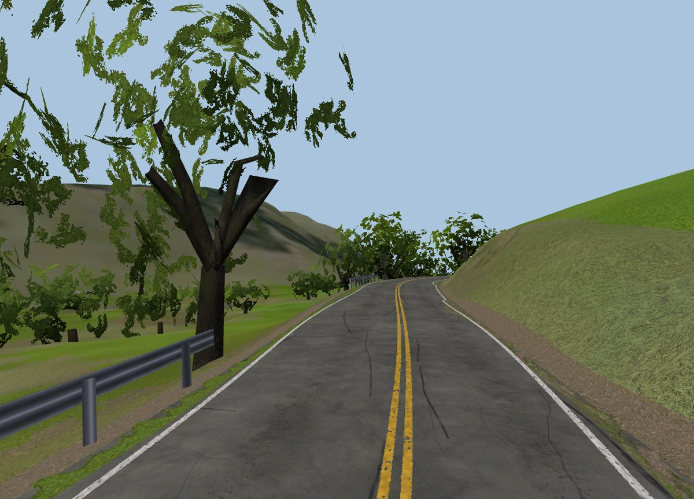
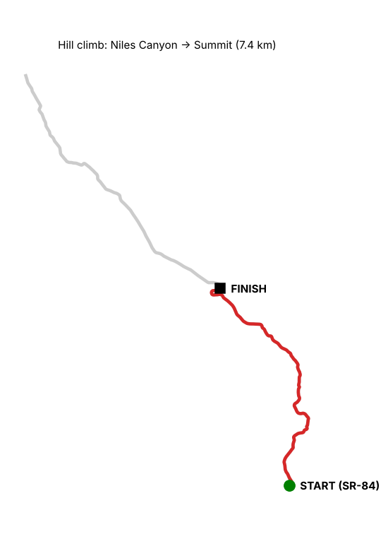
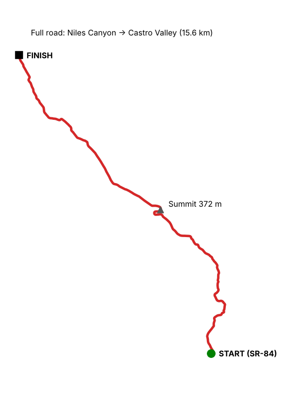
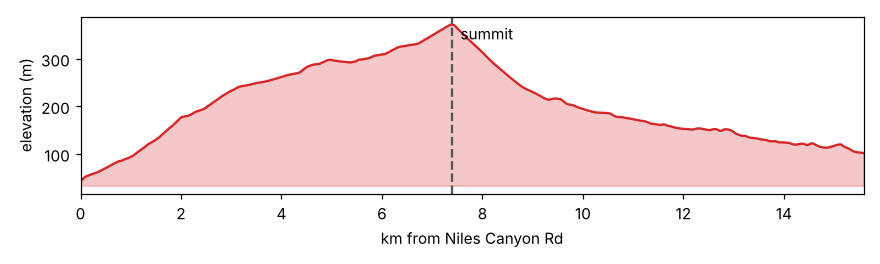

# Palomares Road for Assetto Corsa

A free mod track of **Palomares Road**, a narrow, tree-covered canyon road in the hills between Fremont and Castro Valley, California. It runs 15.6 km from Niles Canyon Road (SR-84) over a 372 m summit and down into Castro Valley.

The road shape, hills, banking and width come from real aerial laser scans (USGS LiDAR), so it drives like the real road.

> **Status: early development builds.** Expect rough visuals in places. Feedback is very welcome (see the end of this page).

## Maps

| Hill climb: Niles Canyon → Summit | Full road: Niles Canyon → Castro Valley |
|---|---|
|  |  |

## Layouts

Each route comes in two styles:
- **Road:** the real road, with real lane markings and no kerbs.
- **Track:** the same road with race kerbs on the corners and no centre line.

| Route | Road style | Track style |
|---|---|---|
| Niles Canyon → Summit (the main hill climb, 7.4 km) | `road_summit` | `track_summit` |
| Summit → Niles Canyon (downhill) | `road_summit_rev` | `track_summit_rev` |
| Summit → Castro Valley | `road_north` | `track_north` |
| Castro Valley → Summit | `road_north_rev` | `track_north_rev` |
| Full road, Niles Canyon → Castro Valley (15.6 km) | `road_full` | `track_full` |
| Full road, reverse | `road_full_rev` | `track_full_rev` |

Every layout is point-to-point: you start at the bottom, and the timer stops at the finish gate. Use **Practice** or **Hotlap** mode.

**Coming next:** a free-roam map that adds the Niles town area and all of Niles Canyon Road. It will have its own Niles Canyon hill-climb layouts.

## Download

Get the newest zip from the [`dist/`](dist/) folder. Click the file, then **Download raw file**. The highest `devN` number is the latest build.

## Install

**With Content Manager (easiest):**
1. Drag the downloaded zip onto the Content Manager window.
2. Click **Install**.

**Without Content Manager:**
1. Unzip the file.
2. Copy the `palomares_road_devN` folder into `steamapps/common/assettocorsa/content/tracks/`.

Then pick **Palomares Road** in the track list and choose a layout.

**Recommended:** Custom Shaders Patch (CSP) and Pure, for better trees, grass and lighting. The track also works without them.

## Feedback

Driving it and something feels off? Open an issue, or send a note with:
- **Where:** distance from the start, or a landmark
- **Layout:** which one you drove
- **What's wrong:** for example a bump, grip, the road width, a missing or misplaced wall, or something that looks wrong
- **A screenshot,** if you can

## Credits

- Road data © OpenStreetMap contributors (ODbL)
- LiDAR elevation and aerial imagery: USGS / The National Map (public domain)
- Textures: ambientCG and Poly Haven (CC0)
- Street-level reference: Mapillary contributors (CC-BY-SA)

---

**Developers:** to rebuild the track yourself, start with [`docs/phase2/INSTALL.md`](docs/phase2/INSTALL.md). Build notes, reports and pipeline details are in [`docs/`](docs/), [`reports/`](reports/) and [`CLAUDE.md`](CLAUDE.md). The build command is `make package`.
