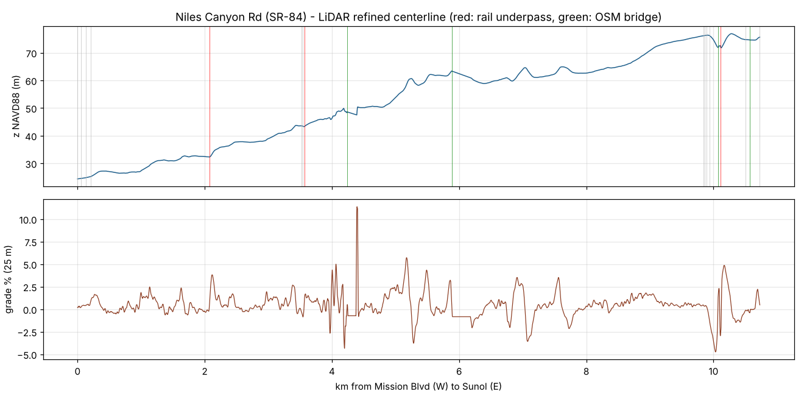
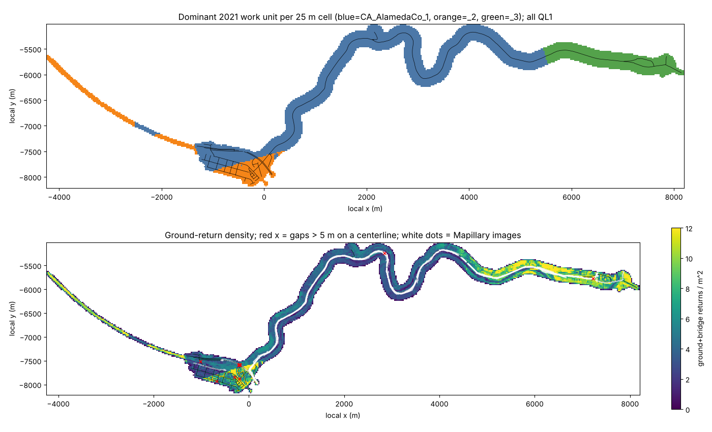

# dev7 data report (work package D)

Scope: Niles town streets, Niles Canyon Rd (SR-84) from Mission Blvd to the Sunol stop, and the connector to the existing Palomares Rd south end. All products are in `data/derived/dev7/`. Coordinates use UTM 10N (EPSG:26910) and NAVD88 m, with the same fixed local origin as Phase 1 (`config/origin.json`, x0=590839.8, y0=4167042.5). Pipeline: `scripts/p7/01..08` (numbered, idempotent).

## Termini (confirmed in OSM)

| Terminus | lon, lat | OSM node | Notes |
|---|---|---|---|
| NCR west: Mission Blvd | -121.971555, 37.576602 | 53068020 | SR-84 Niles Canyon Rd / Mission Blvd (SR-238) signalised junction; Niles Blvd continues W |
| NCR east: Sunol | -121.882237, 37.592892 | 734818893 | Sunol: SR-84 Niles Canyon Rd / Main St / Pleasanton-Sunol Rd all-way STOP (SR-84 continues E as Paloma Rd to I-680) |
| Niles Blvd start | -121.982322, 37.577691 | 2500322399 | Niles Blvd / Sullivan Underpass: start of the block before the Devout Coffee block (block W of ['G Street']), 150 m W of Devout Coffee along Niles Blvd |
| Devout Coffee | -121.980726, 37.577206 | 3424127445 | OSM amenity=cafe, 150 m along the Niles Blvd centerline from the start |
| Palomares Rd south end | -121.946870, 37.597835 | - | on NCR at OSM station 3539 m (distance 0.0 m); refined NCR station in features (junction) |

The Sunol "traffic light / stop sign" is the all-way STOP at Niles Canyon Rd / Main St / Pleasanton-Sunol Rd. OSM has stop nodes there and no signal. The nearest traffic signals are on Calaveras Rd / I-680, about 1.3 km east, outside the scope. SR-84 continues east as Paloma Rd, and the first 345 m are included as a stub.

## Lengths (refined centerlines, 1 m)

| Road | Role | Length (m) | Width p5/p50/p95 (m) | z min-max (m) | max abs grade | snap vs OSM p50/p95 (m) |
|---|---|---|---|---|---|---|
| niles_canyon_road | canyon | 10729 | 5.8/7.7/13.3 | 24.3-76.9 | 30.3% | 0.8/2.9 |
| niles_blvd | town | 1082 | 6.8/8.9/10.2 | 21.7-25.7 | 5.1% | 0.6/2.9 |
| 3rd_street | town | 963 | 7.8/9.1/10.2 | 21.1-24.2 | 2.6% | 1.1/2.2 |
| 2nd_street | town | 951 | 7.5/8.8/9.9 | 20.0-25.3 | 2.1% | 0.8/2.7 |
| mission_boulevard_4 | town | 734 | 9.2/10.4/15.1 | 19.7-32.6 | 3.1% | 0.1/0.4 |
| mission_boulevard | town | 718 | 11.1/13.3/19.0 | 23.1-28.9 | 3.8% | 0.2/0.5 |
| main_street | canyon_side | 672 | 5.7/8.9/10.2 | 74.6-80.7 | 4.2% | 0.4/2.5 |
| mission_boulevard_3 | town | 671 | 10.2/12.7/17.0 | 20.5-32.5 | 3.0% | 0.2/0.3 |
| mission_boulevard_2 | town | 664 | 8.8/12.1/16.5 | 23.4-27.4 | 3.3% | 0.2/0.4 |
| vallejo_way | town | 630 | 5.6/7.2/10.2 | 20.9-31.3 | 4.3% | 0.6/2.0 |
| paloma_road | sunol_stub | 343 | 6.3/7.9/9.2 | 74.9-75.7 | 1.3% | 3.0/4.5 |
| vallejo_street | town | 285 | 7.8/8.8/10.2 | 22.7-24.7 | 4.6% | 0.3/1.3 |
| sycamore_street | town | 271 | 6.0/6.5/10.2 | 24.3-25.3 | 4.9% | 1.9/2.4 |
| i_street | town | 252 | 7.6/9.2/10.2 | 24.2-24.8 | 1.5% | 0.6/1.1 |
| j_street | town | 251 | 8.3/9.7/10.2 | 22.1-25.3 | 7.3% | 0.2/1.1 |
| locomotive_common | town | 250 | 7.0/8.7/10.2 | 22.5-24.3 | 12.1% | 1.4/3.8 |
| h_street | town | 241 | 7.8/8.9/10.2 | 23.1-24.2 | 1.6% | 0.7/1.7 |
| palomares_road | palomares_connector | 240 | 5.9/7.0/8.9 | 43.6-58.0 | 12.7% | 0.4/0.8 |
| g_street | town | 237 | 6.6/7.9/10.2 | 21.9-22.9 | 1.8% | 0.3/1.1 |
| f_street | town | 235 | 5.8/6.6/9.5 | 20.8-21.2 | 3.1% | 0.6/1.3 |
| essanay_place | town | 200 | 7.9/8.7/10.1 | 24.2-25.5 | 2.8% | 1.1/2.7 |
| sullivan_underpass | town | 182 | 4.7/8.4/14.2 | 18.1-22.4 | 12.8% | 0.3/0.6 |
| nichols_avenue | town | 177 | 6.5/6.9/13.7 | 20.2-22.9 | 3.0% | 1.5/2.4 |
| cinematic_common | town | 172 | 8.7/9.5/10.2 | 23.1-26.1 | 4.5% | 0.3/1.3 |
| pleasanton_sunol_road | sunol_stub | 164 | 7.0/8.0/10.2 | 75.6-79.4 | 4.2% | 1.1/3.5 |
| dollar_common | town | 146 | 8.0/10.0/10.2 | 23.2-24.1 | 15.4% | 0.2/1.2 |
| e_street | town | 117 | 7.3/9.0/10.1 | 20.2-20.4 | 3.8% | 0.4/0.9 |
| essanay_avenue | town | 100 | 7.5/8.4/10.1 | 23.5-24.2 | 2.0% | 0.7/1.0 |
| limelight_terrace | town | 93 | 6.6/9.1/10.2 | 21.6-25.9 | 43.5% | 0.8/6.2 |
| sennett_terrace | town | 92 | 8.4/9.6/10.2 | 23.2-24.9 | 15.8% | 0.3/0.7 |
| chase_court | town | 87 | 9.1/9.4/9.9 | 22.2-22.3 | 0.8% | 0.4/0.6 |
| l_street | town | 68 | 6.7/7.2/10.2 | 22.7-22.9 | 1.4% | 1.5/1.7 |
| quincy_terrace | town | 58 | 9.7/10.2/10.2 | 23.3-23.6 | 3.7% | 0.2/0.3 |
| old_canyon_road | town | 55 | 9.8/10.2/10.2 | 24.9-26.0 | 4.0% | 0.5/0.9 |
| sierra_terrace | town | 46 | 8.0/8.3/10.0 | 22.7-24.2 | 19.6% | 1.4/3.1 |
| nichols_court | town | 40 | 6.1/7.3/10.0 | 22.9-23.2 | 2.4% | 0.3/0.8 |
| mayhews_road | town | 35 | 10.2/10.2/10.2 | 31.4-32.6 | 9.0% | 0.0/0.0 |
| palomares_link_1 | palomares_connector | 33 | 5.8/6.9/9.4 | 43.6-44.5 | 5.0% | 0.0/0.0 |

Totals by role: canyon 10.73 km, town 10.10 km, canyon_side 0.67 km, sunol_stub 0.51 km, palomares_connector 0.27 km; all roads 22.28 km.

Mission Blvd is split into its OSM carriageway pieces (`mission_boulevard`, `_2`..`_4`). Roads under 40 m are smoothed only and not snapped. Widths come from DTM flat-strip growth (6 cm tolerance), with curb steps detected on town streets. They are capped by OSM lanes (lanes x 1.9 m + 1.6 m per side), so treat town widths with curbs and parked cars as approximate.

## Niles Canyon Rd profile (Mission Blvd to Sunol)

- Length 10729 m. Start z 24.3 m, end z 75.6 m, net +51.3 m.
- Highest point 76.9 m at s=10279 m; lowest 24.3 m at s=0 m. The canyon climbs gently eastward along Alameda Creek, with no summit in the hill-climb sense. The "climb" is the creek gradient.
- Grade (25 m mean): p50 +0.40%, p5 -1.47%, p95 +2.72%, max abs 11.4% (s=4395 m). Share of length > 4%: 2.1%.
- Total ascent 81 m, descent 30 m (W to E, on the smoothed profile).
- Width p5/p50/p95 5.8/7.7/13.3 m. Curvature: tightest radius 21 m.
- **rail_underpass** (3): 2072 Niles Canyon Railway (DSM 6.84 m over road); 3565 Niles Canyon Railway (DSM 6.78 m over road); 10110 UP Oakland Subdivision (DSM 5.86 m over road)
- **road_over_rail** (1): 5948 UP Oakland Subdivision
- **bridge_osm** (4): 4242-4387 Niles Canyon Road; 5884-6187 Niles Canyon Road; 10075-10097; 10569-10664 Niles Canyon Road
- **bridge_lidar_class17** (3): 4338-4355; 5887-6192; 10569-10665
- **culvert_candidate** (8): 1552; 2445; 2492; 3430 Stonybrook Creek; 4919; 5660; 6719; 7548
- **stream_crossing_bridge** (3): 4337 Alameda Creek; 6072 Alameda Creek; 10625 Arroyo de la Laguna
- **traffic_signals** (1): 16
- **stop** (2): 7047; 10714

## Features (all roads)

| kind | count |
|---|---|
| barrier_osm | 8 |
| bridge_lidar_class17 | 5 |
| bridge_osm | 6 |
| canyon_high_point | 1 |
| canyon_low_point | 1 |
| crossing | 59 |
| culvert_candidate | 15 |
| curb | 149 |
| guardrail_candidate | 44 |
| junction | 144 |
| level_crossing | 4 |
| lidar_gap | 10 |
| rail_ped_crossing | 2 |
| rail_road_crossing | 1 |
| rail_tunnel_under_road | 1 |
| rail_underpass | 9 |
| road_over_rail | 1 |
| steep_drop | 17 |
| stop | 24 |
| stream_crossing_bridge | 5 |
| traffic_signals | 4 |
| wall_or_steep_cut | 28 |

The railway underpass(es) on SR-84 are where the Niles Canyon Railway / UP lines cross over the road. `dsm_over_road_m` is the first-surface height above the road surface, which is the top of the structure, not the clearance. The flashing warning signs before the underpass are not in OSM and LiDAR can't resolve them. Package M must place them from Mapillary.

## LiDAR coverage and quality

- Source: USGS 3DEP EPT `CA_AlamedaCo_1/2/3_2021` (QL1, the same sets as Phase 1), streamed and reprojected EPSG:3857 to UTM 10N. Share of ground returns by work unit: {'CA_AlamedaCo_1_2021': 50.5, 'CA_AlamedaCo_2_2021': 19.6, 'CA_AlamedaCo_3_2021': 29.9}.
- Classes present: {'1': 188065488, '2': 24885953, '7': 216306, '9': 503962, '17': 458845, '18': 390539, '20': 56465}. There is no 3-6 vegetation or building classification, so trees and buildings come from the CHM (DSM - DTM). Class 17 (bridge deck) is present (458,845 points) and is used as drivable ground.
- Ground returns (deduplicated): 25,127,427. Areas: town polygon 0.651 km2, 40 m detail 1.945 km2, 150 m terrain 4.3 km2.
- Rasters: `dtm_r050_b40` (0.5 m, detail area), `dtm_r100_b150` (1 m), `dsm_r100_b150`, `chm_r100_b150`, `gdist_r050_b40` (gap diagnostic), `int_r050_b40` (intensity), `cover_r100_b150` (first/ground/bridge counts).

## Gaps and uncertain sections

Ground-return gaps longer than 5 m on a centerline (gap length = run with no return within 1 m, plus 2 x max distance):

| road | s start-end (m) | gap (m) | canopy | bridge pts | likely cause |
|---|---|---|---|---|---|
| 3rd_street | 447-453 | 11.7 | 1.00 | 0 | dense canopy |
| locomotive_common | 220-225 | 11.4 | 1.00 | 0 | dense canopy |
| mission_boulevard | 191-195 | 9.6 | 1.00 | 0 | dense canopy |
| mission_boulevard | 200-203 | 8.0 | 1.00 | 0 | dense canopy |
| mission_boulevard_2 | 148-153 | 10.9 | 1.00 | 0 | dense canopy |
| mission_boulevard_2 | 158-161 | 8.3 | 1.00 | 0 | dense canopy |
| niles_blvd | 858-865 | 16.4 | 1.00 | 0 | dense canopy |
| niles_canyon_road | 4332-4343 | 16.1 | 0.20 | 79 | bridge/structure |
| niles_canyon_road | 10090-10114 | 43.1 | 0.50 | 0 | structure/vehicle/water or overpass |
| sullivan_underpass | 82-94 | 24.1 | 0.80 | 0 | dense canopy |

## Mapillary coverage (index only, CC-BY-SA 4.0)

16,304 images within 40 m of a dev7 road (`mapillary_index.csv`). Years: {'2018': 3575, '2023': 12729}. Panoramas: 0.

| road | images | 100 m bins covered | newest |
|---|---|---|---|
| niles_canyon_road | 15312 | 108/108 | 2023 |
| mission_boulevard_2 | 458 | 7/7 | 2023 |
| main_street | 156 | 2/7 | 2023 |
| niles_blvd | 85 | 6/11 | 2018 |
| mission_boulevard | 76 | 8/8 | 2023 |
| pleasanton_sunol_road | 52 | 2/2 | 2018 |
| sycamore_street | 36 | 1/3 | 2023 |
| old_canyon_road | 35 | 1/1 | 2023 |
| vallejo_way | 20 | 3/7 | 2018 |
| mission_boulevard_3 | 18 | 2/7 | 2018 |
| palomares_road | 14 | 1/3 | 2023 |
| e_street | 11 | 1/2 | 2018 |
| f_street | 11 | 1/3 | 2018 |
| palomares_link_1 | 9 | 1/1 | 2023 |
| mayhews_road | 6 | 1/1 | 2018 |
| sullivan_underpass | 5 | 1/2 | 2018 |
| 2nd_street | 0 | 0/10 | - |
| 3rd_street | 0 | 0/10 | - |
| chase_court | 0 | 0/1 | - |
| cinematic_common | 0 | 0/2 | - |
| dollar_common | 0 | 0/2 | - |
| essanay_avenue | 0 | 0/2 | - |
| essanay_place | 0 | 0/3 | - |
| g_street | 0 | 0/3 | - |
| h_street | 0 | 0/3 | - |
| i_street | 0 | 0/3 | - |
| j_street | 0 | 0/3 | - |
| l_street | 0 | 0/1 | - |
| limelight_terrace | 0 | 0/1 | - |
| locomotive_common | 0 | 0/3 | - |
| mission_boulevard_4 | 0 | 0/8 | - |
| nichols_avenue | 0 | 0/2 | - |
| nichols_court | 0 | 0/1 | - |
| paloma_road | 0 | 0/4 | - |
| quincy_terrace | 0 | 0/1 | - |
| sennett_terrace | 0 | 0/1 | - |
| sierra_terrace | 0 | 0/1 | - |
| vallejo_street | 0 | 0/3 | - |

Niles Canyon Rd has full coverage in both directions. In the town, Niles Blvd and Mission Blvd are covered, but most side streets (2nd St, 3rd St, G/H/I/J St) have no Mapillary images. Package M will have to use NAIP or LiDAR for those, or mark them unverified.

## Float precision

See `docs/dev7/DECISIONS.md` (D7-1). The farthest dev7 point is about 10.1 km from the fixed origin (the Sunol stub), and Niles town is about 8.6 km away.

## Attribution

OpenStreetMap contributors (ODbL 1.0); USGS 3DEP (public domain); Mapillary contributors (CC-BY-SA 4.0, index only).
