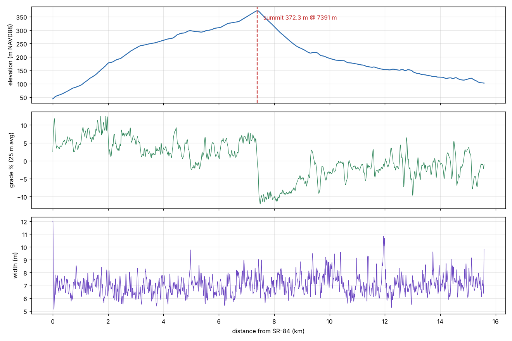
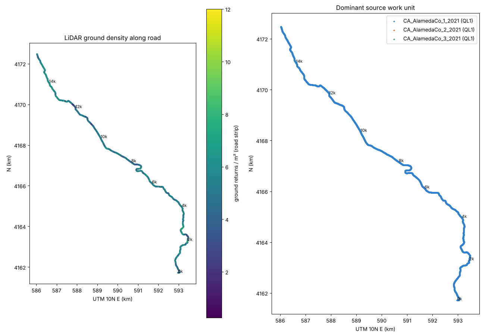

# Phase 1 report — Palomares Road corridor

_Generated by `scripts/10_report.py`. All distances are metres from the southern terminus at Niles Canyon Rd (SR-84), measured along the refined centerline. CRS EPSG:26910 (UTM 10N), heights NAVD88 (GEOID18) metres. Local origin: E 590839.8, N 4167042.5._

## Summary

| Item | Value |
|---|---|
| Total length (refined centerline) | **15584 m** (9.68 mi) |
| South terminus (SR-84 / Niles Canyon Rd) | 37.5978349, -121.9468698 — 43.6 m |
| North terminus (Castro Valley, Palomares Rd @ Eden Canyon Rd/I-580) | 37.6954904, -122.0241221 — 102.2 m |
| **Summit (Phase 2 finish)** | **s = 7391 m, 372.3 m** (1221 ft) at 37.6446369, -121.9668132 |
| Climb SR-84 → summit | 329 m net, avg grade 4.4% |
| Total ascent / descent (S→N) | 360 m / 301 m |
| Grade (1 m) max up / max down | 13.3% / -13.1% |
| Grade (10 m avg) 95th pct abs | 9.8% |
| Road width min / 5% / median / 95% / max | 5.1 / 6.0 / 7.0 / 8.3 / 12.0 m |
| Crossfall (median abs, left / right half) | 4.3% / 4.3% |
| Tight corners (R < 40 m) | 24; tightest R ≈ 18 m at s = 77 m |
| Trees mapped (≥4 m, ≤60 m from road) | 9067 (median height 16 m, max 40 m) |
| LiDAR | USGS 3DEP CA_AlamedaCounty_2021_B21, **QL1** throughout (Riegl VQ-1560ii, NVA 4.0 cm @95%) |
| Ground returns on road strip (±4 m) | median 5.4 /m², 5th pct 3.0 /m² |
| Height check vs USGS EPQS 1 m DEM (12 pts) | see `data/derived/epqs_check.csv`; max |Δ| ≤ 0.17 m |

## Grade statistics

| Grade bin (10 m avg) | Share of length |
|---|---|
| < -12% | 0.1% |
| -12..-8% | 8.8% |
| -8..-4% | 10.1% |
| -4..0% | 28.1% |
| 0..4% | 26.0% |
| 4..8% | 21.8% |
| 8..12% | 4.8% |
| > 12% | 0.4% |

Per-kilometre summary:

| km | z start → end (m) | avg grade | max grade (10 m) | median width | min width |
|---|---|---|---|---|---|
| 0–1 | 44 → 94 | +5.0% | 12.4% | 7.0 | 5.1 |
| 1–2 | 94 → 177 | +8.3% | 13.2% | 6.9 | 5.6 |
| 2–3 | 177 → 233 | +5.6% | 9.5% | 6.6 | 5.5 |
| 3–4 | 233 → 262 | +2.9% | 7.0% | 6.8 | 5.4 |
| 4–5 | 262 → 298 | +3.6% | 9.5% | 6.8 | 5.5 |
| 5–6 | 298 → 309 | +1.2% | 6.8% | 7.0 | 5.5 |
| 6–7 | 309 → 350 | +4.0% | 7.1% | 6.8 | 5.4 |
| 7–8 | 350 → 314 | -3.6% | 12.6% | 7.1 | 5.6 |
| 8–9 | 314 → 230 | -8.3% | 11.6% | 7.1 | 5.8 |
| 9–10 | 230 → 195 | -3.5% | 9.3% | 7.5 | 6.0 |
| 10–11 | 195 → 173 | -2.2% | 6.9% | 7.0 | 5.6 |
| 11–12 | 173 → 153 | -2.1% | 5.6% | 6.9 | 5.8 |
| 12–13 | 153 → 147 | -0.6% | 9.6% | 6.9 | 5.3 |
| 13–14 | 146 → 125 | -2.2% | 10.1% | 7.1 | 6.1 |
| 14–15 | 125 → 117 | -0.7% | 7.2% | 7.2 | 5.9 |
| 15–16 | 117 → 102 | -2.6% | 8.2% | 7.2 | 6.1 |

## LiDAR coverage and quality

All three 2021 Alameda County work units (`CA_AlamedaCo_1/2/3_2021`) are Quality Level 1. Work unit 1 provides almost all of the corridor. The 2006 dataset was not needed. Vegetation is **not** classified in this delivery (classes 1, 2, 7, 9, 17, 18 and 20 only), so canopy was derived from DSM − DTM rather than from classes 3–5.

Share of centerline by dominant work unit: CA_AlamedaCo_1_2021: 100.0%, CA_AlamedaCo_2_2021: 0.0%, CA_AlamedaCo_3_2021: 0.0%

## Gaps and uncertain sections

A gap is a stretch where no ground return lies within 2.5 m of the centerline for more than 5 m. A sparse section has fewer than 0.5 ground pts/m² over 10 m. In both cases the surface was filled by TIN interpolation.

| s start (m) | s end (m) | length (m) | type |
|---|---|---|---|
| — | — | — | none found |

Other uncertain items:

- **Wide sections (> 9.5 m)**: 6 spots. These are probably turnouts, driveway aprons or junctions picked up as road by the flatness-based edge detector. Check them in the viewer: 0–14 m, 4981–4988 m, 10394–10400 m, 11940–12000 m, 13734–13741 m, 15581–15584 m
- **Road markings**: no Mapillary token was provided, so markings come only from LiDAR intensity, which is weak at ~5 ground pts/m². Center-line detection per 50 m: {'not_detected': 183, 'possible': 89, 'likely': 40}. The default assumption is a **double yellow center line** along the full length (`markings.csv`). Confirm type and breaks with photos.
- **Bridges/culverts**: 8 bridge spans (OSM + LiDAR class 17), 20 stream crossings (culverts assumed).
- **Guardrails**: 78 candidate runs from a height-above-ground signature (0.35–1.05 m returns just outside the edge, little at 1.3–3 m). These are low-confidence because of vegetation, fences and parked cars, so check them against photos.
- **Steep faces** (cut or wall, > 1.5 m rise within 2 m of edge): 119 runs. **Steep drops** (> 1.2 m fall within 2 m): 71 runs. LiDAR cannot tell a rock cut from a retaining wall.

## Edge environment (share of length)

| class | left | right |
|---|---|---|
| cut_bank | 24.1% | 35.7% |
| ditch | 1.2% | 0.9% |
| drop_off | 36.8% | 22.5% |
| flat | 25.9% | 22.8% |
| steep_drop | 4.4% | 3.9% |
| wall_or_steep_cut | 7.6% | 14.3% |

## Features extracted

| kind | count |
|---|---|
| bridge_lidar_class17 | 7 |
| bridge_osm | 1 |
| driveway | 72 |
| guardrail_candidate | 78 |
| junction | 12 |
| sign | 2 |
| steep_drop | 71 |
| steep_face | 119 |
| stream_crossing | 20 |
| summit | 1 |

## Corner screenshots

Viewer captures of the tightest corners (driver's eye, uphill direction, plus overhead) are in [`assets/`](../assets/README.md).

## Method notes

1. OSM ways 1190239384 → 116299847 → 116299515 → 79430605 were joined into one line (the spurs 6368528 and 6368499 were excluded).
2. USGS EPT (EPSG:3857) nodes intersecting a 150 m buffer were streamed and reprojected to UTM 10N **before any measurement**. Z is already NAVD88 metres in the EPT. This was checked against EPQS.
3. DTM: Delaunay TIN of ground and bridge-deck returns per 250 m chunk with ±250 m overlap. 0.5 m within 40 m, 1 m within 150 m.
4. Centerline: two-pass Viterbi search for the offset whose 5.5 m window best fits a plane (RMS + cross-slope penalty, smoothness prior). This was followed by Gaussian and quintic smoothing-spline resampling at 1 m, which keeps curvature continuous.
5. Cross-sections: the left and right half-planes were fitted on ±2.5 m. Each edge is the last 0.25 m bin within 6 cm of the extrapolated plane. Width was median-filtered over 21 m and clamped to 2.4–6 m per side. Edge environment uses the height relative to the road plane at 2 m and 5 m beyond the edge.
6. Trees: local maxima (5 m window) of the smoothed 1 m CHM above 4 m. Crown radius comes from the canopy area (> 50% of peak) assigned to the nearest peak.
